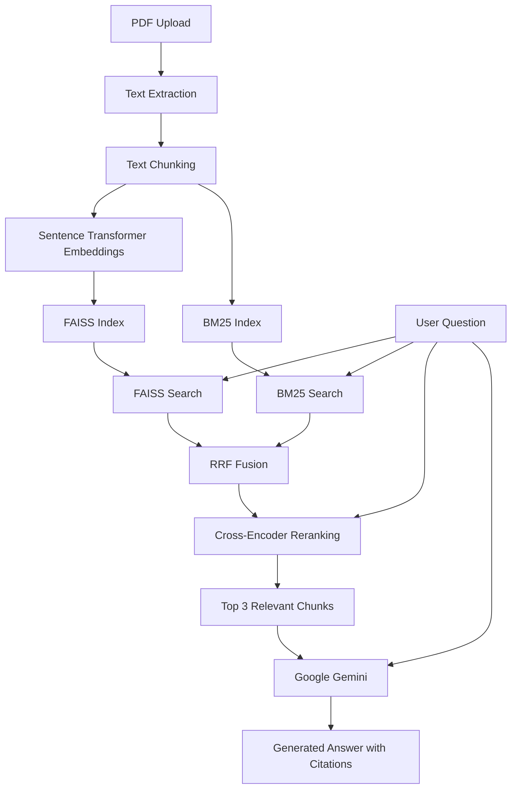

# Hybrid RAG PDF Question Answering System

## 🚀 Live Application

**Try the AI PDF Research Assistant:**

[Launch Live RAG Application](https://hybrid-rag-pdf-assistant.streamlit.app/)

**Explore the source code:**

[GitHub Repository](https://github.com/polishettisaibaba/hybrid-rag-pdf-assistant)

---


## Project Overview

This project is an end-to-end Retrieval-Augmented Generation (RAG) application built using Python and Streamlit.

Users can upload a PDF document, ask questions about its content, and receive AI-generated answers supported by retrieved document sources.

The application combines semantic search (FAISS) and keyword search (BM25) to retrieve relevant information. Reciprocal Rank Fusion (RRF) combines the retrieval results, and a Cross-Encoder reranks the candidate passages before sending the most relevant context to Google Gemini.

The goal of this project is to explore how different retrieval techniques work together to build a more reliable, source-grounded question-answering system.


## RAG Architecture

Our RAG application follows these stages:

1. **PDF Processing:** Extract text from the uploaded PDF and divide it into overlapping chunks.

2. **Semantic Search (FAISS):** Convert chunks into embeddings using Sentence Transformers and retrieve semantically relevant chunks.

3. **Keyword Search (BM25):** Retrieve chunks based on keyword relevance.

4. **Reciprocal Rank Fusion (RRF):** Combine the FAISS and BM25 rankings to identify the top candidate chunks.

5. **Cross-Encoder Reranking:** Evaluate each question–chunk pair and rerank the retrieved candidates.

6. **LLM Answer Generation:** Send the top 3 reranked chunks to Google Gemini to generate an answer grounded in the PDF.

7. **Source Verification:** Display the supporting PDF chunks so users can inspect the evidence.





## Technology Stack

- **Python:** Core application development
- **Streamlit:** Interactive web application
- **PyPDF:** PDF text extraction
- **LangChain Text Splitters:** Splitting PDF text into overlapping chunks
- **Sentence Transformers:** Generating text embeddings
- **FAISS:** Semantic vector search
- **BM25:** Keyword-based retrieval
- **Reciprocal Rank Fusion (RRF):** Combining retrieval rankings
- **Cross-Encoder:** Reranking retrieved chunks based on relevance
- **Google Gemini:** Generating answers using retrieved PDF context
- **NumPy:** Numerical operations


## Installation and Setup

### 1. Clone the Repository

Download the project from GitHub and navigate into the project directory:

```bash
git clone YOUR_REPOSITORY_URL
cd RAG_Project_1
```


### 2. Create a Virtual Environment

Create an isolated Python environment for the project:

```bash
python3 -m venv .venv
```


### 3. Activate the Virtual Environment


For macOS/Linux:

```bash
source .venv/bin/activate
```

For Windows PowerShell:

```powershell
.venv\Scripts\Activate.ps1
```

After activation, your terminal may display a prefix similar to:

```text
(.venv) user@mac RAG_Project_1 %
```

This indicates that the virtual environment is active.


### 4. Install Project Dependencies

Install the Python libraries required for the RAG application:

```bash
python -m pip install -r requirements.txt
```


### 5. Configure the Gemini API Key

The application uses Google Gemini for answer generation.

Create your own Gemini API key and configure it as an environment variable.

For macOS/Linux:

```bash
export GEMINI_API_KEY="YOUR_GEMINI_API_KEY"
```

Replace `YOUR_GEMINI_API_KEY` with your own API key.

**Security Note:** Never upload your actual API key to GitHub or include it directly in the Python source code.


### 6. Run the Streamlit Application

After installing the dependencies and configuring the Gemini API key, launch the application:

```bash
python -m streamlit run app.py
```

Streamlit starts a local web server. By default, the application is usually available at:

http://localhost:8501

Upload a PDF document, enter a question, and click **Get Answer**.

The application retrieves relevant document chunks, generates an answer using Google Gemini, and displays the supporting PDF sources.

Expand **View Retrieved PDF Sources** to inspect the retrieved passages.


## Retrieval Evaluation

The retrieval pipeline was evaluated using three manually labelled questions.

Two retrieval metrics were used:

- **Hit@5:** Measures whether at least one relevant chunk appears among the top 5 retrieved results.
- **MRR@5:** Measures how highly the first relevant chunk is ranked within the top 5 results.

### Evaluation Results

| Retrieval Method | Hit@5 | MRR@5 |
|---|---:|---:|
| FAISS | 1.0000 | 0.7333 |
| BM25 | 0.6667 | 0.2222 |
| RRF | 1.0000 | 1.0000 |
| Cross-Encoder | 1.0000 | 0.8333 |

### Observations

- FAISS retrieved relevant chunks for all three evaluation questions.
- BM25 achieved a lower retrieval score on this small evaluation set.
- RRF achieved the highest MRR@5 in this experiment.
- Cross-Encoder reranking achieved Hit@5 of 1.0000, but its MRR@5 was lower than RRF.

**Limitation:** These results are based on only three questions. A larger, carefully labelled evaluation dataset is required before drawing reliable conclusions about which retrieval method performs best.


## Limitations and Future Improvements

This project demonstrates an end-to-end hybrid RAG pipeline. However, there are several opportunities for improvement.

### Current Limitations

- Retrieval evaluation was performed using only three manually labelled questions.
- The application currently processes one uploaded PDF at a time.
- The system uses a fixed chunk size and overlap, which may not be optimal for every document.
- Answer quality has not yet been evaluated using a large, systematic test dataset.
- The application has not been tested for production-scale usage.

### Future Improvements

- Expand the evaluation dataset with more questions and verified relevant chunks.
- Experiment with different chunk sizes, overlaps, and embedding models.
- Add support for multiple PDF documents.
- Introduce automated answer-quality evaluation, including faithfulness and citation accuracy.
- Improve error handling, performance monitoring, and deployment readiness.
